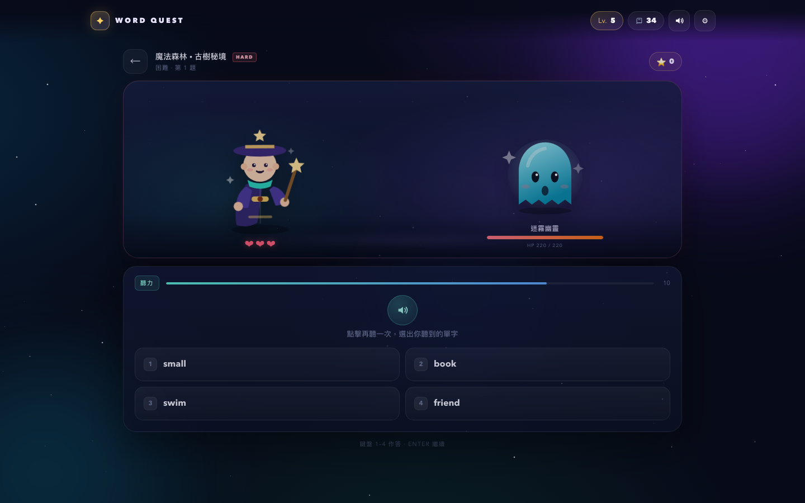

# 單字遠征 · Word Quest

用 RPG 打怪學英文的單頁網頁遊戲。90 個單字、3 個世界、12 道關卡，支援正常／困難模式。

## 🎮 立即遊玩

**https://s20260039-wq.github.io/word-quest/**

## 玩法

- 答對攻擊怪物，答錯扣生命值；連擊愈高傷害愈大
- 題型：中譯英、英譯中、聽力、Boss 拼字
- 答錯自動加入錯題本，答對後移除
- 單字圖鑑收錄 90 個單字、詞性、例句與英文發音
- 等級、星星、錯題進度自動儲存在瀏覽器

## 難度

| 模式 | 生命 | 一般題時間 | 特色 |
|---|---|---|---|
| 正常 | 5 顆心 | 約 20 秒 | 首字母提示、節奏較寬裕 |
| 困難 | 3 顆心 | 約 13 秒 | 更多拼字與聽力、不設首字母、XP ×1.5 |

可在首頁或設定切換；戰鬥中切換會於下一場生效。

## 本機遊玩

下載 `index.html`，直接用瀏覽器開啟即可，無需安裝或網絡。

## 自動部署

每次推送或合併到 `main`，GitHub Actions 會自動將 `index.html` 部署到 GitHub Pages。  
Workflow：`.github/workflows/deploy.yml`

## 技術

- 單檔 HTML / CSS / JavaScript，無外部依賴
- Web Speech API 英文朗讀
- localStorage 儲存進度
