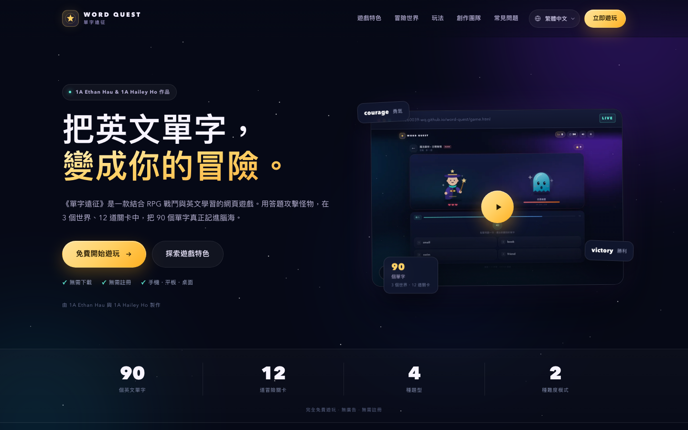
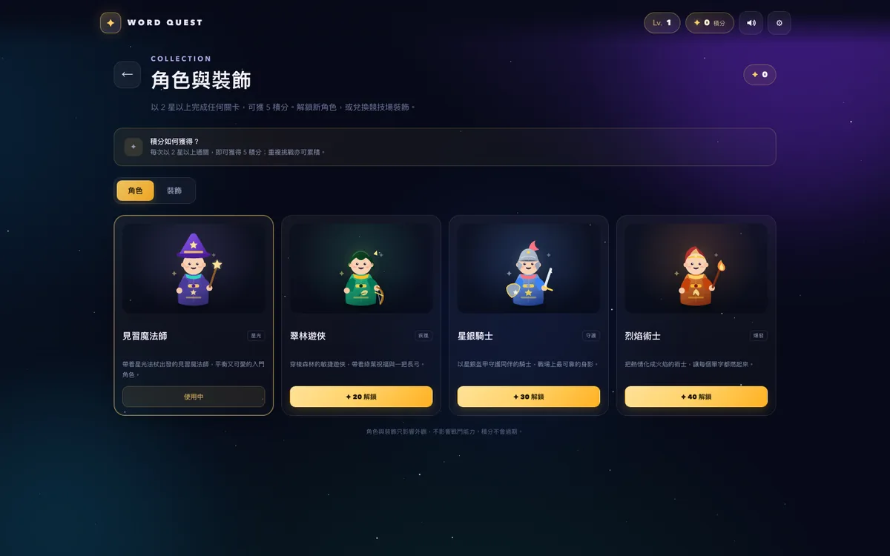

# 單字遠征 Word Quest

把英文單字溫習變成 RPG 冒險的免費網頁遊戲，配有一個完整的三語商業網站。

**官方網站：** https://s20260039-wq.github.io/word-quest/  
**直接遊玩：** https://s20260039-wq.github.io/word-quest/game.html

**作者：** 1A Ethan Hau、1A Hailey Ho



## 網站亮點

- **三語介面**：繁體中文、简体中文、English；語言選擇會自動儲存，亦可用 `?lang=en` 直接分享。
- **產品介紹**：Hero、學習理念、六大特色、三個世界、遊戲畫面、學習設計、難度、積分與收藏、創作團隊、FAQ 與 CTA。
- **即時試玩**：所有「立即遊玩」按鈕會開啟遊戲 modal；亦可另開新視窗或直接前往 `game.html`。
- **完整保留遊戲**：單字戰鬥、難度、錯題溫習、單字圖鑑、發音與進度儲存全部保留；`localStorage` 進度與舊版共用同一網域。
- **作者署名**：1A Ethan Hau、1A Hailey Ho 顯示於網站 Hero、創作團隊、Footer 及遊戲頁。
- **響應式設計**：手機、平板、桌面皆已調整，包含全螢幕手機選單與試玩視窗。
- **SEO / 分享**：Canonical、Open Graph、Twitter Card、JSON-LD、`robots.txt`、`sitemap.xml` 及自訂 OG 封面。

## 遊戲特色

- 90 個英文單字、3 個世界、12 道關卡
- 中譯英、英譯中、聽力、Boss 拼字四種題型
- 正常與困難模式：3／5 顆心、不同限時、XP ×1.5
- 錯題自動收集、重點複習、90 字單字圖鑑
- Web Speech API 英文發音
- 進度、星星、等級、錯題與收藏自動儲存

## 積分與收藏

- **每次以 2 星以上完成關卡可獲 5 積分**，重複挑戰亦可累積。
- 積分可解鎖 **3 位全新角色**：翠林遊俠、星銀騎士、烈焰術士。
- 積分可兌換 **5 款競技場裝飾**（另設 1 款預設星塵主題）：櫻花漫舞、極光帷幕、黃金慶典、霜月流光、螢火之森。
- 新角色會套用到遊戲大廳與戰鬥；裝飾會改變戰鬥競技場的背景與粒子效果。
- 角色與裝飾只影響外觀，不影響戰鬥能力。



> 遊戲介面以繁體中文呈現；網站本身提供繁體中文、简体中文及 English。

## 專案結構

```
index.html                  # 商業網站首頁
game.html                   # 完整遊戲（原有功能 + 積分收藏）
assets/
  site.css                  # 網站樣式
  site.js                   # 語言切換、選單、modal、動畫
  favicon.svg
  game-home.webp
  game-battle.webp
  game-wordbook.webp
  game-result.webp
  game-shop.webp
  og-cover.jpg
previews/                   # README 及遊戲截圖
robots.txt
sitemap.xml
.github/workflows/deploy.yml
```

## 本機預覽

```bash
cd word-quest
python3 -m http.server 8000
```

然後打開 `http://localhost:8000/`。

## 自動部署

每次 push 或合併到 `main`，GitHub Actions 會自動把 `index.html`、`game.html`、`assets/`、`robots.txt` 及 `sitemap.xml` 部署到 GitHub Pages。  
Workflow：`.github/workflows/deploy.yml`

## 技術

- 單頁 HTML / CSS / JavaScript，無外部框架
- 原生 Web Speech API、localStorage
- GitHub Actions + GitHub Pages
